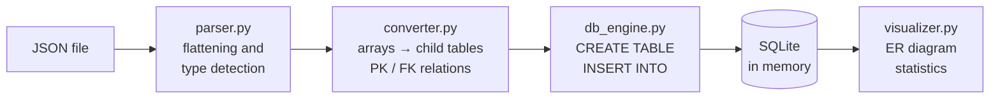
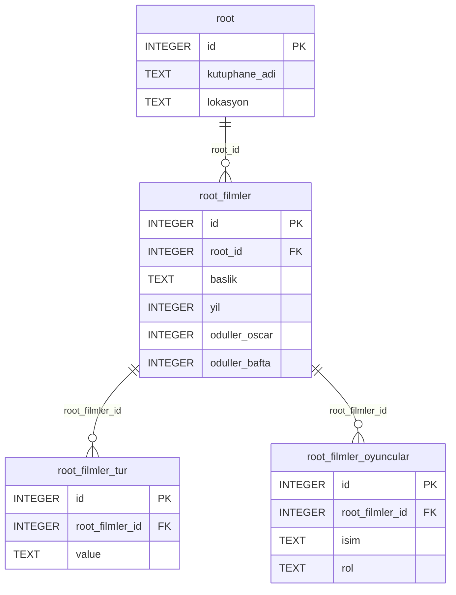

# NoSQL → SQL Converter Engine

A Python desktop application that analyses nested, schema-less JSON and converts it into
**normalized, linked SQL tables**. No schema has to be defined in advance: tables, columns, data
types and the relations between tables are all derived from the data.

[Türkçe README](README.md)


- **Language:** Python 3.9+ — standard library only, nothing else to install
- **GUI:** Tkinter (`ttk`, `Canvas`)
- **Database:** SQLite, in memory (`:memory:`)

Third project of the Programming Laboratory II course, Department of Computer Engineering,
Kocaeli University.

Developed by Enes Canlı

> The user interface and the sample data are in Turkish.

## Highlights

- **Nesting of any depth.** The JSON is walked recursively; nested objects are flattened into
  columns (`oduller.oscar` → `oduller_oscar`) and arrays are moved into child tables.
- **Automatic normalization (1NF).** Every cell holds a single value. Each table gets an
  auto-increment `id` primary key and child tables reference their parent through a
  `<parent_table>_id` foreign key.
- **Heterogeneous records.** When array items introduce new fields, the table is extended with
  `ALTER TABLE`; earlier rows keep the new column empty.
- **Safe naming.** Names with spaces, hyphens or SQL reserved words such as `order` are quoted.
  A JSON `id` field is kept in a `json_id` column so it never clashes with the generated key.
- **See the result.** The generated schema, table data, a draggable ER diagram, a row-count chart
  per table and a log of every `CREATE` / `INSERT` / `ALTER` step are shown in the app.

## Type mapping

| JSON | SQL |
|---|---|
| string | `TEXT` |
| integer | `INTEGER` |
| float | `REAL` |
| boolean (`true` / `false`) | `INTEGER` (1 / 0) |

## How it works



**Example:** a shortened version of `test_data/film_kutuphanesi.json`

```json
{
  "kutuphane_adi": "Merkez Sinema Arşivi",
  "lokasyon": "İstanbul",
  "filmler": [
    {
      "baslik": "Inception",
      "yil": 2010,
      "tur": ["Bilim Kurgu", "Aksiyon"],
      "oyuncular": [{ "isim": "Leonardo DiCaprio", "rol": "Cobb" }],
      "oduller": { "oscar": 4, "bafta": 3 }
    }
  ]
}
```

is turned into these tables:



## Usage

```bash
git clone https://github.com/CanliEnes/nosql-to-sql-converter.git
cd nosql-to-sql-converter
python Main.py
```

1. Click **📂 JSON Yükle** (Load JSON) and pick a file from `test_data`.
2. Click **🔄 Dönüştür** (Convert): the schema, tables, ER diagram and statistics appear instantly.
3. Load another file or press **🗑 Sıfırla** (Reset) to start over.

## Screenshots

| JSON view | Generated SQL schema |
|---|---|
|  |  |

## Sample data

| File | Contents |
|---|---|
| `test_data/kisi.json` | A person with address and contact details, hobbies, work history and skills |
| `test_data/siparis.json` | Customer, products, product tags, payment and shipping |
| `test_data/film_kutuphanesi.json` | Films, genres, actors and awards |
| `test_data/hastane_kayit.json` | Patients, visits and prescriptions |
| `test_data/universite.json` | Faculty → department → course → lecturer (5 levels deep) |

## Project layout

| Path | Contents |
|---|---|
| `Main.py` | Tkinter application (entry point) |
| `modules/parser.py` | Recursive JSON flattening and type detection |
| `modules/converter.py` | Normalization, child tables and PK/FK relations |
| `modules/db_engine.py` | `CREATE TABLE` / `INSERT` / `ALTER TABLE` on SQLite |
| `modules/visualizer.py` | ER diagram and statistics chart |
| `test_data/` | Sample JSON files |
| `docs/` | README images |

## License

MIT
