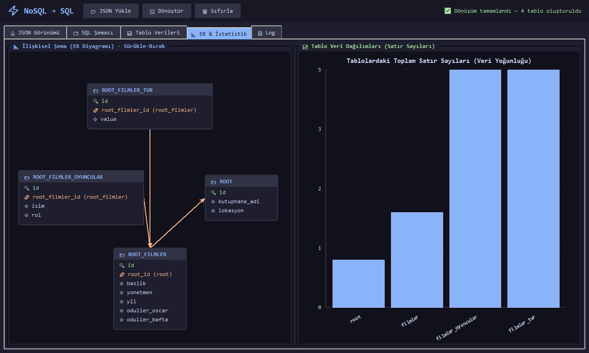
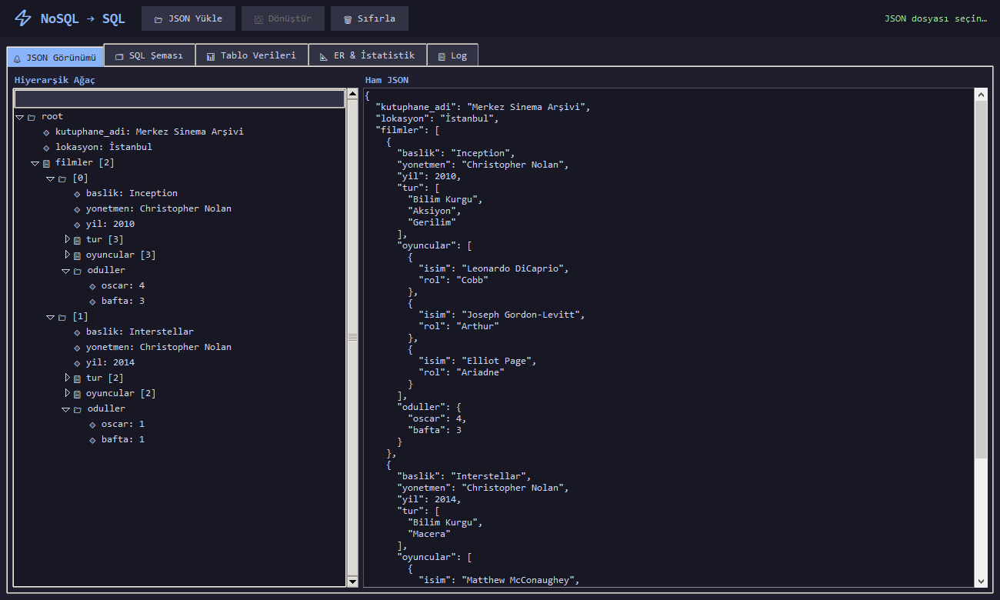
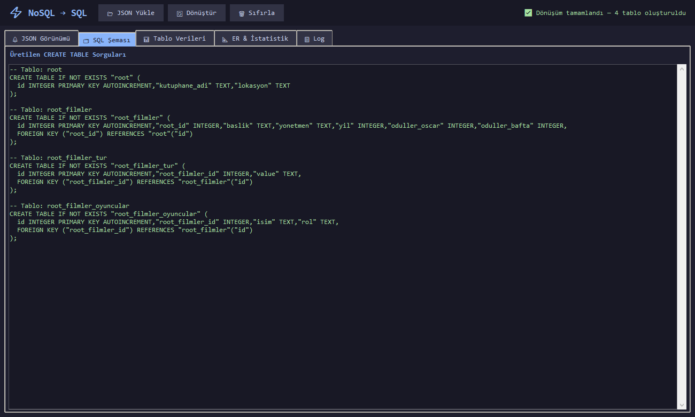
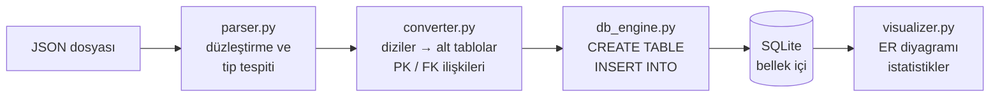
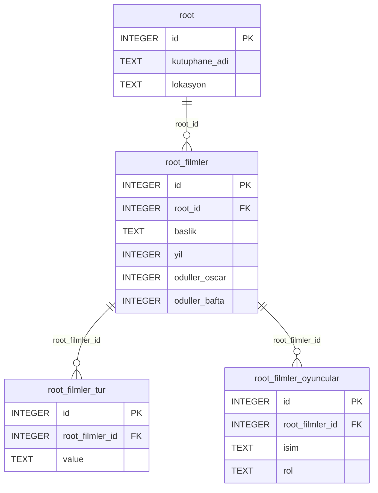

<div align="center">

# NoSQL → SQL Dönüşüm Motoru 🔄

**NoSQL to SQL Converter Engine**

İç içe geçmiş, şemasız JSON verisini otomatik olarak analiz edip normalize edilmiş,
birbirine bağlı SQL tablolarına dönüştüren Python uygulaması.


[Türkçe](#türkçe) · [English](#english)



**Geliştiren:** Enes CANLI

</div>

---

## Türkçe

### Proje hakkında

Kocaeli Üniversitesi Bilgisayar Mühendisliği **Programlama Laboratuvarı II** dersi kapsamında
III. proje olarak geliştirildi. Amaç, şemasız (NoSQL) ve ilişkisel (SQL) veri modelleri arasındaki
farkı göstermek ve aradaki dönüşümü programla yapmaktır.

Uygulama, önceden tanımlanmış bir şemaya ihtiyaç duymaz. Gelen JSON'u özyinelemeli (recursive)
olarak dolaşır, iç içe nesneleri sütunlara açar, dizileri ayrı tablolara taşır ve tabloları
birincil / yabancı anahtarlarla birbirine bağlar.

### Ekran görüntüleri

| JSON görünümü | Üretilen SQL şeması |
|---|---|
|  |  |

### Özellikler

- **Dinamik JSON çözümleme:** Derinliği ne olursa olsun iç içe nesneler düzleştirilir
  (`oduller.oscar` → `oduller_oscar` sütunu).
- **Otomatik normalizasyon:**
  - Diziler ayrı alt tablolara çıkarılır; her hücrede tek değer kalır (1NF).
  - Her tabloya otomatik artan bir `id` birincil anahtarı eklenir.
  - Alt tablolar üst tabloya yabancı anahtarla (`<üst_tablo>_id`) bağlanır.
- **Otomatik veri tipi tespiti:** metin → `TEXT`, tam sayı → `INTEGER`, ondalık → `REAL`,
  mantıksal → `INTEGER` (0/1).
- **Farklı yapıdaki kayıtlar:** Bir dizinin elemanlarında yeni alanlar çıkarsa tablo
  `ALTER TABLE` ile genişletilir.
- **Güvenli adlandırma:** Boşluk, tire veya `order` gibi SQL'e ayrılmış kelime içeren adlar
  sorunsuz işlenir. JSON'daki `id` alanı, otomatik anahtarla çakışmaması için `json_id`
  sütununda korunur.
- **Etkileşimli ER diyagramı:** Tablolar ve aralarındaki ilişkiler oklarla çizilir; kartlar
  fareyle sürüklenebilir.
- **İstatistik grafiği:** Her tablodaki satır sayısı çubuk grafikte gösterilir; üzerine
  gelince değer görünür.
- **Tablo verileri ve log:** Oluşan tablolar uygulama içinde incelenebilir, her adım
  (`CREATE`, `INSERT`, `ALTER`) log sekmesinde izlenebilir.

### Nasıl çalışır?



**Örnek:** `test_data/film_kutuphanesi.json` dosyasının kısaltılmış hâli

```json
{
  "kutuphane_adi": "Merkez Sinema Arşivi",
  "lokasyon": "İstanbul",
  "filmler": [
    {
      "baslik": "Inception",
      "yil": 2010,
      "tur": ["Bilim Kurgu", "Aksiyon"],
      "oyuncular": [{ "isim": "Leonardo DiCaprio", "rol": "Cobb" }],
      "oduller": { "oscar": 4, "bafta": 3 }
    }
  ]
}
```

şu tablolara dönüşür:



### Kullanılan teknolojiler

| Araç | Ne için |
|---|---|
| **Python 3.9+** | Bütün proje |
| **SQLite** (`sqlite3`) | Bellek içi ilişkisel veritabanı |
| **Tkinter** (`ttk`, `Canvas`) | Arayüz, ER diyagramı ve grafik çizimi |
| `json` | JSON okuma |

Hepsi Python'un standart kütüphanesinde bulunur; ek kurulum gerekmez.

### Çalıştırma

```bash
git clone https://github.com/CanliEnes/nosql-to-sql-converter.git
cd nosql-to-sql-converter
python Main.py
```

1. **📂 JSON Yükle** ile `test_data` klasöründen bir dosya seçin.
2. **🔄 Dönüştür**'e basın; şema, tablolar, ER diyagramı ve istatistikler hemen oluşur.
3. Yeni bir dosyaya geçmek için tekrar yükleyin ya da **🗑 Sıfırla**'ya basın.

### Örnek veriler

| Dosya | İçerik |
|---|---|
| `kisi.json` | Kişi, adres ve iletişim bilgileri, hobiler, iş geçmişi ve beceriler |
| `siparis.json` | Müşteri, ürünler, ürün etiketleri, ödeme ve kargo bilgisi |
| `film_kutuphanesi.json` | Filmler, türler, oyuncular ve ödüller |
| `hastane_kayit.json` | Hastalar, ziyaretler ve reçeteler |
| `universite.json` | Fakülte → bölüm → ders → öğretim üyesi (5 seviye iç içe) |

### Proje yapısı

```
├── Main.py                 Tkinter uygulaması (giriş noktası)
├── modules/
│   ├── parser.py           Özyinelemeli JSON düzleştirme ve tip tespiti
│   ├── converter.py        Normalizasyon ve dönüşümün yönetimi
│   ├── db_engine.py        SQLite üzerinde CREATE TABLE / INSERT işlemleri
│   └── visualizer.py       ER diyagramı ve istatistik grafiği
├── test_data/              Örnek JSON dosyaları
└── docs/                   README görselleri
```

---

## English

### About

Developed as the third project of the **Programming Laboratory II** course at Kocaeli University,
Department of Computer Engineering. It demonstrates the difference between schema-less (NoSQL)
and relational (SQL) data models and converts between them programmatically.

The tool needs no predefined schema. It walks the incoming JSON recursively, flattens nested
objects into columns, moves arrays into their own tables and links the tables with primary and
foreign keys.

> The user interface and the sample data are in Turkish.

### Screenshots

| JSON view | Generated SQL schema |
|---|---|
|  |  |

### Features

- **Dynamic JSON parsing:** nested objects of any depth are flattened
  (`oduller.oscar` → column `oduller_oscar`).
- **Automatic normalization:**
  - Arrays are extracted into child tables so every cell holds a single value (1NF).
  - Every table gets an auto-increment `id` primary key.
  - Child tables reference their parent through a foreign key (`<parent_table>_id`).
- **Type detection:** string → `TEXT`, integer → `INTEGER`, float → `REAL`, boolean → `INTEGER` (0/1).
- **Heterogeneous records:** when array items introduce new fields, the table is extended with
  `ALTER TABLE`.
- **Safe naming:** names with spaces, hyphens or SQL reserved words such as `order` are handled.
  A JSON `id` field is kept in a `json_id` column so it never clashes with the generated key.
- **Interactive ER diagram:** tables and their relations are drawn with arrows; cards can be dragged.
- **Statistics chart:** a bar chart of row counts per table, with values shown on hover.
- **Table data and log:** browse the generated tables and follow every `CREATE`, `INSERT` and
  `ALTER` step in the log tab.

### How it works

See the [diagrams in the Turkish section](#nasıl-çalışır): `parser.py` flattens the data and detects
types, `converter.py` builds child tables and PK/FK relations, `db_engine.py` runs the SQL on an
in-memory SQLite database and `visualizer.py` draws the ER diagram and statistics.

### Tech stack

| Tool | Used for |
|---|---|
| **Python 3.9+** | The whole project |
| **SQLite** (`sqlite3`) | In-memory relational database |
| **Tkinter** (`ttk`, `Canvas`) | GUI, ER diagram and chart rendering |
| `json` | Reading JSON |

Everything is part of the Python standard library; nothing else needs to be installed.

### Usage

```bash
git clone https://github.com/CanliEnes/nosql-to-sql-converter.git
cd nosql-to-sql-converter
python Main.py
```

1. Click **📂 JSON Yükle** (Load JSON) and pick a file from `test_data`.
2. Click **🔄 Dönüştür** (Convert): the schema, tables, ER diagram and statistics appear instantly.
3. Load another file or press **🗑 Sıfırla** (Reset) to start over.
