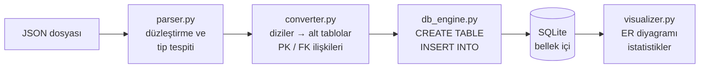
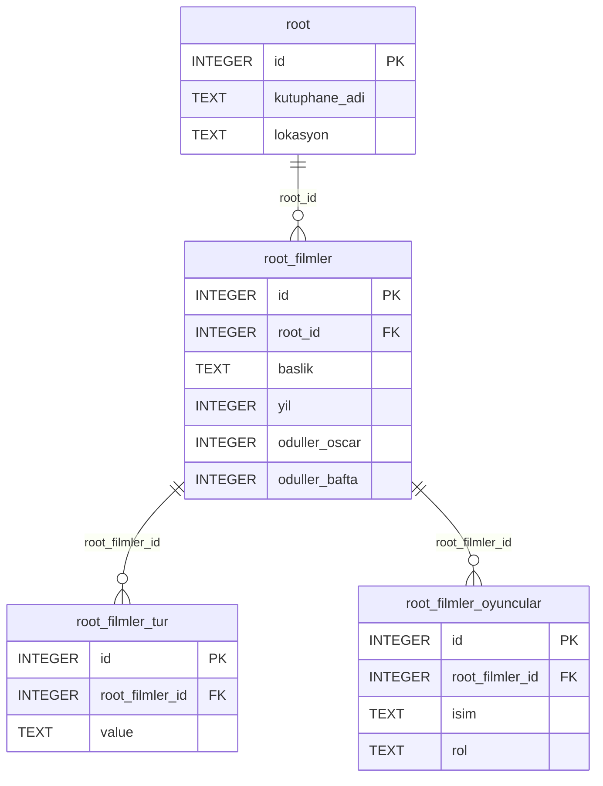

# NoSQL → SQL Dönüşüm Motoru

İç içe geçmiş, şemasız JSON verisini otomatik olarak çözümleyip **normalize edilmiş, birbirine
bağlı SQL tablolarına** dönüştüren bir Python masaüstü uygulaması. Önceden tanımlanmış bir şemaya
ihtiyaç duymaz; tabloları, sütunları, veri tiplerini ve tablolar arası ilişkileri veriden çıkarır.

[English README](README.en.md)


- **Dil:** Python 3.9+ — yalnızca standart kütüphane, ek paket kurulumu gerekmez
- **Arayüz:** Tkinter (`ttk`, `Canvas`)
- **Veritabanı:** SQLite, bellek içi (`:memory:`)

Kocaeli Üniversitesi Bilgisayar Mühendisliği, Programlama Laboratuvarı II dersinin III. projesi.

Geliştiren: Enes Canlı

## Öne çıkanlar

- **Her derinlikte iç içe veri.** JSON özyinelemeli (recursive) olarak dolaşılır; iç içe nesneler
  sütunlara açılır (`oduller.oscar` → `oduller_oscar`), diziler ayrı alt tablolara taşınır.
- **Otomatik normalizasyon (1NF).** Her hücrede tek değer kalır. Her tabloya otomatik artan bir
  `id` birincil anahtarı eklenir, alt tablolar üst tabloya `<üst_tablo>_id` yabancı anahtarıyla
  bağlanır.
- **Farklı yapıdaki kayıtlar.** Bir dizinin elemanlarında yeni alanlar çıkarsa tablo
  `ALTER TABLE` ile genişletilir; eski satırlarda bu sütun boş kalır.
- **Güvenli adlandırma.** Boşluk, tire veya `order` gibi SQL'e ayrılmış kelime içeren adlar
  tırnaklanarak işlenir. JSON'daki `id` alanı, otomatik anahtarla çakışmaması için `json_id`
  sütununda korunur.
- **Sonucu görerek inceleme.** Üretilen şema, tablo verileri, sürüklenebilir ER diyagramı, tablo
  başına satır sayısı grafiği ve her `CREATE` / `INSERT` / `ALTER` adımının günlüğü uygulama içinde
  görülür.

## Veri tipi eşlemesi

| JSON | SQL |
|---|---|
| metin | `TEXT` |
| tam sayı | `INTEGER` |
| ondalık sayı | `REAL` |
| mantıksal (`true` / `false`) | `INTEGER` (1 / 0) |

## Nasıl çalışır?




**Örnek:** `test_data/film_kutuphanesi.json` dosyasının kısaltılmış hâli

```json
{
  "kutuphane_adi": "Merkez Sinema Arşivi",
  "lokasyon": "İstanbul",
  "filmler": [
    {
      "baslik": "Inception",
      "yil": 2010,
      "tur": ["Bilim Kurgu", "Aksiyon"],
      "oyuncular": [{ "isim": "Leonardo DiCaprio", "rol": "Cobb" }],
      "oduller": { "oscar": 4, "bafta": 3 }
    }
  ]
}
```

şu tablolara dönüşür:




## Çalıştırma

```bash
git clone https://github.com/CanliEnes/nosql-to-sql-converter.git
cd nosql-to-sql-converter
python Main.py
```

1. **📂 JSON Yükle** ile `test_data` klasöründen bir dosya seçin.
2. **🔄 Dönüştür**'e basın; şema, tablolar, ER diyagramı ve istatistikler hemen oluşur.
3. Yeni bir dosyaya geçmek için tekrar yükleyin ya da **🗑 Sıfırla**'ya basın.

## Ekran görüntüleri

| JSON görünümü | Üretilen SQL şeması |
|---|---|
|  |  |

## Örnek veriler

| Dosya | İçerik |
|---|---|
| `test_data/kisi.json` | Kişi, adres ve iletişim bilgileri, hobiler, iş geçmişi ve beceriler |
| `test_data/siparis.json` | Müşteri, ürünler, ürün etiketleri, ödeme ve kargo bilgisi |
| `test_data/film_kutuphanesi.json` | Filmler, türler, oyuncular ve ödüller |
| `test_data/hastane_kayit.json` | Hastalar, ziyaretler ve reçeteler |
| `test_data/universite.json` | Fakülte → bölüm → ders → öğretim üyesi (5 seviye iç içe) |

## Klasör yapısı

| Yol | İçerik |
|---|---|
| `Main.py` | Tkinter uygulaması (giriş noktası) |
| `modules/parser.py` | Özyinelemeli JSON düzleştirme ve tip tespiti |
| `modules/converter.py` | Normalizasyon, alt tablolar ve PK/FK ilişkileri |
| `modules/db_engine.py` | SQLite üzerinde `CREATE TABLE` / `INSERT` / `ALTER TABLE` |
| `modules/visualizer.py` | ER diyagramı ve istatistik grafiği |
| `test_data/` | Örnek JSON dosyaları |
| `docs/` | README görselleri |

## Lisans

MIT
